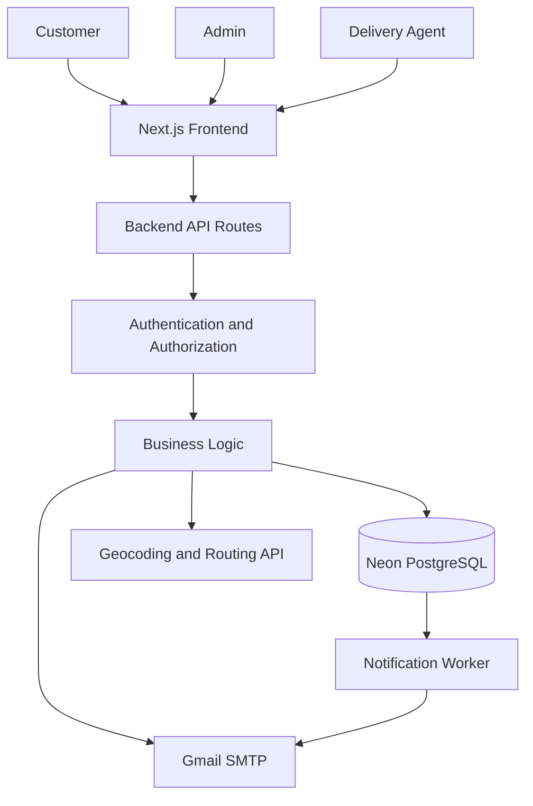
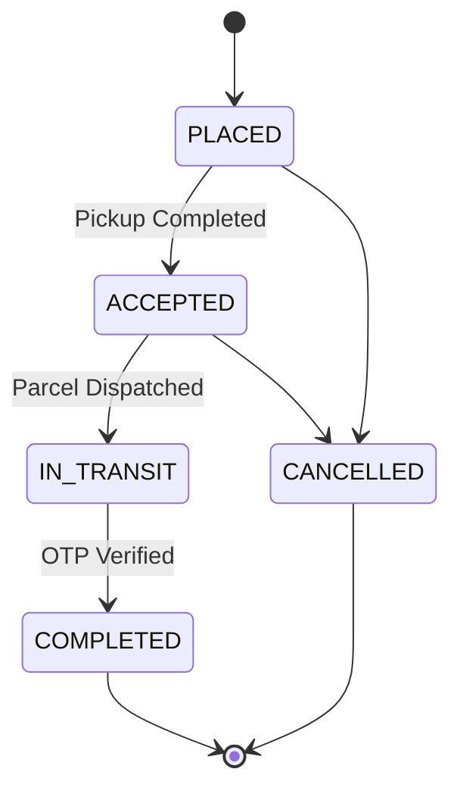

# InShip — Parcel Delivery & Logistics Management


## Overview

InShip is a full-stack parcel delivery and logistics management platform that connects customers, administrators, and delivery agents through dedicated role-based dashboards.

The platform provides parcel booking, distance-based pricing, shipment tracking, agent management, OTP-secured delivery, and automated email notifications.

## Key Features

### Customer
- Secure registration and login.
- Email verification using OTP.
- Parcel booking and delivery price estimation.
- Sent and incoming parcel management.
- Shipment tracking and delivery notifications.
- Automatic receiver account linking.

### Administrator
- Centralized administration dashboard.
- Manage parcel bookings and shipment status.
- Assign pickup and delivery agents.
- Dispatch and cancel eligible orders.
- Monitor agent assignments.

### Delivery Agent
- Dedicated agent dashboard.
- View assigned pickup and delivery tasks.
- Complete parcel pickup.
- OTP-based delivery confirmation.
- Manage pending and completed assignments.

## Technology Stack

| Category | Technology |
| --- | --- |
| Frontend | Next.js, React, TypeScript |
| Styling | Tailwind CSS |
| Backend | Node.js, Next.js API Routes |
| Database | Neon PostgreSQL |
| Authentication | JWT, bcrypt |
| Authorization | Role-Based Access Control |
| Routing | OpenRouteService |
| Email Service | Nodemailer, Gmail SMTP |
| Background Processing | Node.js Worker |
| Version Control | Git and GitHub |

## System Architecture



## Shipment Lifecycle



## Database Design

| Table | Purpose |
| --- | --- |
| User | User accounts and roles |
| Order | Parcel booking details |
| AgentAssignment | Pickup and delivery assignments |
| TrackingEvent | Shipment tracking history |
| EmailVerification | Account verification OTP |
| DeliveryVerification | Delivery confirmation OTP |
| Notification | Email notification queue |

## Security

- JWT-based session authentication.
- Password hashing using bcrypt.
- Role-based access control (RBAC).
- Server-side authorization and input validation.
- Parameterized SQL queries.
- HMAC-SHA256 OTP hashing.
- OTP expiration, attempt limits, and resend cooldown.
- Database transactions and row-level locking.
- Secure environment variable management.

## Email Notification System

InShip uses Nodemailer and Gmail SMTP for OTP verification and shipment notifications.

A PostgreSQL-backed notification queue and a separate Node.js worker handle asynchronous shipment emails, with persistent storage and automatic retries.

## Project Structure

```text
inship/
├── src/
│   ├── app/
│   │   ├── api/
│   │   ├── admin/
│   │   ├── agent/
│   │   ├── dashboard/
│   │   ├── orders/
│   │   ├── login/
│   │   ├── signup/
│   │   └── verify-email/
│   ├── components/
│   └── lib/
│       ├── auth.ts
│       ├── auth-db.ts
│       ├── routing.ts
│       ├── pricing.ts
│       ├── email.ts
│       ├── otp.ts
│       └── notifications.ts
├── scripts/
│   └── notification-worker.mjs
├── public/
├── package.json
└── README.md
```

## Getting Started

### 1. Clone the Repository

```bash
git clone <repository-url>
cd inship
```

### 2. Install Dependencies

```bash
npm install
```

### 3. Configure Environment Variables

Create a `.env` file and configure:

- Neon PostgreSQL connection URL.
- JWT signing secret.
- OpenRouteService API key.
- Gmail SMTP credentials.
- OTP secret.

Use the environment variable names defined in the project source code.

Never commit sensitive credentials to GitHub.

### 4. Configure Database

Initialize the required PostgreSQL tables and apply the necessary database migrations.

### 5. Run the Application

```bash
npm run dev
```

Open [http://localhost:3000](http://localhost:3000).

### 6. Start the Notification Worker

Run in a separate terminal:

```bash
node scripts/notification-worker.mjs
```

## Known Limitations

- Geocoding endpoint migration is pending due to an HTTP 410 error.
- Address resolution may be limited to city or district-level accuracy.
- Agent assignment and privileged role provisioning are currently manual.
- Notification worker requires final end-to-end testing.
- Fresh database setup requires migration verification.

## Future Enhancements

- Live GPS-based shipment tracking.
- Online payment integration.
- Automated agent onboarding and role management.
- Address autocomplete and improved PIN verification.
- Automatic agent assignment and route optimization.
- QR-based parcel identification.
- Advanced logistics analytics.
- Production deployment and monitoring.

---

**InShip — Simplifying Parcel Delivery Through Technology.**